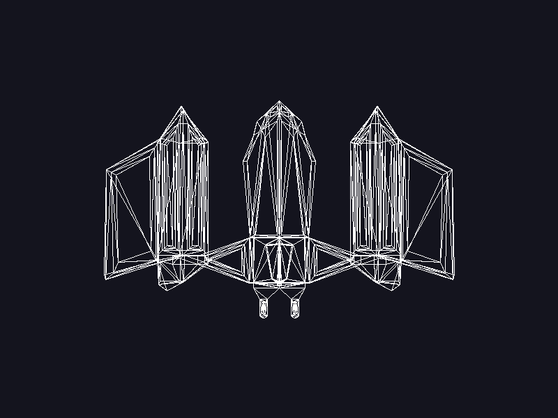
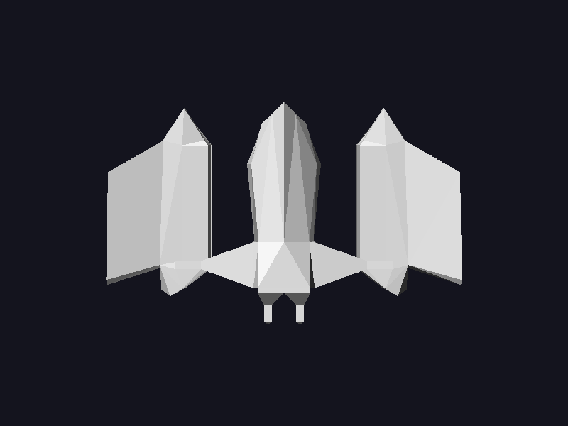
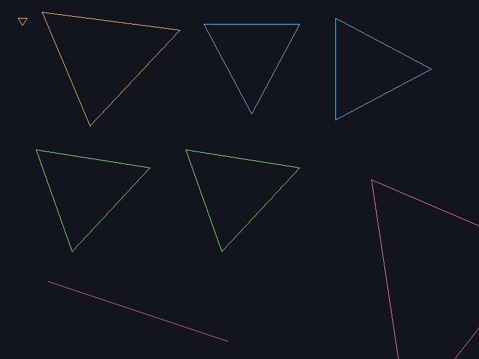
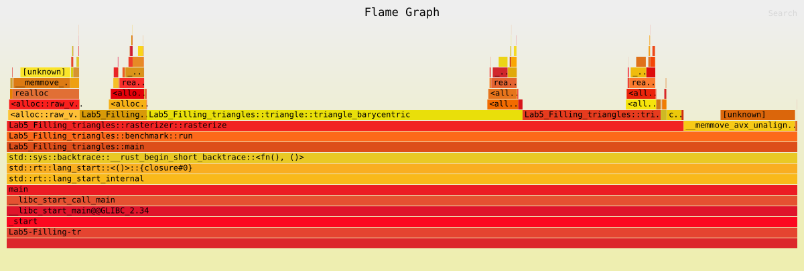

# Laboratorio 5 — Rellenar triángulos

Continuación del laboratorio 4 (rama `lab4-cargar-modelo`), donde se cargó el modelo OBJ ([`assets/nave.obj`](assets/nave.obj), 802 triángulos) con un cargador propio y se dibujaron sus triángulos como contorno. En este laboratorio esos triángulos se rellenan con dos algoritmos y se comparan.

```bash
cargo run --release                            # ventana: 1, 2, 3 cambian el modo; TAB cambia a la escena de pruebas; flechas rotan
cargo run --release -- --comparar              # comparación de posiciones
cargo run --release -- --benchmark-triangles   # mediciones, sin ventana
```

## Modos

`TriangleMode` tiene tres modos. Cada uno es una función en `src/triangle.rs` que recibe los tres vértices y devuelve un `Vec<Fragment>`:

- **Wireframe**: tres llamadas a `line`.
- **FilledBarycentric**: recorre el rectángulo envolvente y evalúa el centro de cada píxel `(x + 0.5, y + 0.5)` con las funciones de arista. No depende del orden de los vértices, y si el área es 0 no genera fragmentos.
- **FilledScanline**: ordena los vértices por `y` y, en cada fila, llena el tramo entre los cortes con las aristas.

| Contorno | Baricéntrico | Scanline |
|---|---|---|
|  |  |  |
|  |  |  |

Abajo está la escena de pruebas:
- Pequeño y grande (amarillos).
- Borde horizontal y borde vertical (azules).
- Orden normal e inverso (verdes).
- Parcialmente fuera (rosado).
- Colineal: en el contorno se ve como una línea y en los rellenos no genera nada.

Los rellenos llevan sombreado plano y z-buffer solo para que se distingan las caras de la nave. Eso no cambia los fragmentos generados.

## Diferencias

Se compararon las posiciones `(x, y)` generadas, triángulo por triángulo:

| Caso | Baricéntrico | Scanline | Solo baricéntrico | Solo scanline |
|---|---:|---:|---:|---:|
| pequeño | 90 | 90 | 0 | 0 |
| grande | 20645 | 20645 | 0 | 0 |
| borde horizontal | 12000 | 12000 | 0 | 0 |
| borde vertical | 13600 | 13600 | 0 | 0 |
| orden normal | 15245 | 15245 | 0 | 0 |
| orden inverso | 15245 | 15245 | 0 | 0 |
| parcialmente fuera | 52380 | 52380 | 0 | 0 |
| colineal | 0 | 0 | 0 | 0 |
| nave (desde arriba) | 175692 | 175692 | 1 | 1 |

Ningún algoritmo genera posiciones duplicadas, y el orden inverso da exactamente las mismas posiciones que el orden normal.

**Regla de cada implementación** cuando el centro de un píxel cae justo en un borde:
- **Baricéntrico**: regla arriba-izquierda. El píxel cuenta solo si la arista es superior o izquierda.
- **Scanline**: intervalos medio abiertos `[y_min, y_max)` y `[x_izq, x_der)`. Se incluye el borde izquierdo o superior y se excluye el derecho o inferior. Esto también resuelve los vértices que caen justo en una fila y las aristas horizontales.

La única diferencia es el píxel (574, 354) de la nave. Su centro cae casi sobre la arista que comparten dos triángulos:
- El baricéntrico obtiene ±0.00055 por el redondeo de `f32` y asigna el píxel a uno de los triángulos.
- El scanline calcula el corte en exactamente 574.5 y lo asigna al otro.

En ambos el píxel se pinta una sola vez, así que la imagen final es idéntica.

## Mediciones

Medido en modo release con `Instant` y `black_box`, contando solo la generación de fragmentos. Cada medición son 100 ejecuciones seguidas, repetidas 15 veces, y se reporta la mediana.

**Casos de prueba**

| Algoritmo | Fragmentos | Mediana por 100 ejecuciones | Por ejecución |
|---|---:|---:|---:|
| Contorno | 4153 | 2.93 ms | 0.029 ms |
| Baricéntrico | 129205 | 264.53 ms | 2.645 ms |
| Scanline | 129205 | 217.80 ms | 2.178 ms |

Scanline es **1.21 veces** más rápido que baricéntrico.

**Nave desde arriba**

| Algoritmo | Fragmentos | Mediana por 100 ejecuciones | Por ejecución |
|---|---:|---:|---:|
| Contorno | 92630 | 73.80 ms | 0.738 ms |
| Baricéntrico | 175692 | 228.79 ms | 2.288 ms |
| Scanline | 175692 | 99.25 ms | 0.992 ms |

Scanline es **2.31 veces** más rápido que baricéntrico.

Los dos rellenos generan los mismos fragmentos. La nave tiene muchos triángulos delgados, cuyo rectángulo envolvente es mucho más grande que el triángulo. El baricéntrico evalúa todos esos píxeles de más, mientras que el scanline solo recorre los de adentro.

## Perfil



Generado con `cargo flamegraph -- --benchmark-triangles`. Para que las pilas salieran bien usé *frame pointers* y `--no-inline`. `triangle_barycentric` y `triangle_scanline` llevan `#[inline(never)]` para que aparezcan como bloques propios.

| Dónde | % de muestras |
|---|---:|
| `triangle_barycentric` | 42.7 |
| ↳ cálculos y creación de fragmentos | 38.2 |
| ↳ crecimiento del `Vec` | 3.7 |
| `triangle_scanline` | 18.2 |
| ↳ cálculos y creación de fragmentos | 13.1 |
| ↳ crecimiento del `Vec` | 4.1 |
| `line` | 6.3 |
| `rasterize`: unir los `Vec` de cada triángulo (`extend`) | 16.3 |
| Kernel: fallos de página y liberar memoria | 13.9 |
| Otros | 2.6 |

- Cerca del **42 %** del tiempo es manejo de memoria: el crecimiento de los `Vec`, el `extend` y el kernel. Pesa tanto como la geometría.
- Generando los mismos fragmentos, el código propio del baricéntrico (38 %) pesa unas 3 veces más que el del scanline (13 %). Ese costo extra está en evaluar píxeles fuera del triángulo.
