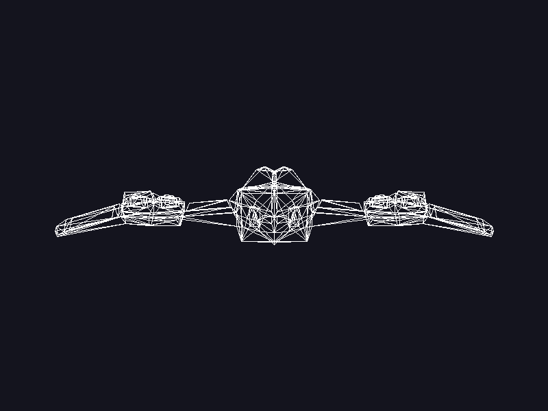

# Laboratorio 4: Dibujando un modelo OBJ

Renderer en Rust que carga un modelo `.obj` con un cargador propio y dibuja todos sus triángulos con las funciones `line` y `triangle`, sin usar las funciones de Raylib para cargar o dibujar modelos 3D. Raylib solo se usa para abrir la ventana y mostrar el framebuffer.

## Resultado



Modelo: [`assets/nave.obj`](assets/nave.obj), una nave hecha en Blender y exportada con caras trianguladas.

| Dato | Valor |
|---|---|
| Vértices | 401 |
| Índices | 2406 |
| Triángulos | 802 |

## Cómo funciona

```
Archivo OBJ → Vértices + índices → Triángulos → Líneas → Píxeles → Pantalla
```

1. **Cargador (`src/obj.rs`)**: `load_obj` lee el archivo línea por línea.
   - Las líneas `v x y z` se convierten en un `Vector3` y se guardan en `vertices`.
   - Las líneas `f a b c` se guardan en `indices`. De cada grupo (`1/4/2`) se toma solo el primer número y se le resta 1, porque OBJ numera desde 1 y un `Vec` de Rust desde 0.
   - Las demás líneas se ignoran.
2. **Recorrido del modelo (`src/main.rs`)**: los índices se recorren de tres en tres. Con cada grupo se buscan los tres vértices y se dibuja el triángulo.
3. **Posición en pantalla**: se usan directamente las componentes `x` e `y` de cada vértice. Se escalan para que el modelo ocupe el 80 % de la ventana, se centran y se invierte `y`, porque en el framebuffer `y` crece hacia abajo.
4. **Dibujo**: `triangle` (`src/triangle.rs`) llama tres veces a `line` (`src/line.rs`, algoritmo de Bresenham), y cada línea escribe sus píxeles en el framebuffer.

Como solo se usan `x` e `y`, la nave se ve de frente y sin perspectiva.

## Ejecutar

```bash
cargo run --release
```

Para regenerar la captura sin abrir la ventana:

```bash
cargo run --release -- --captura
```
